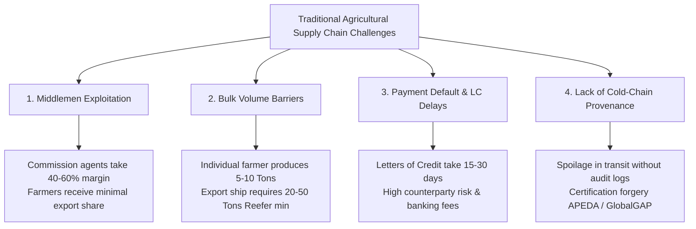
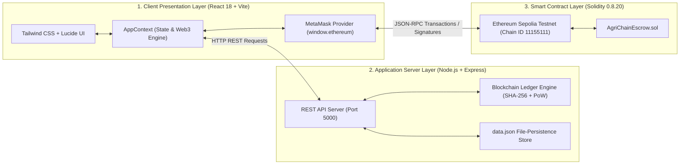
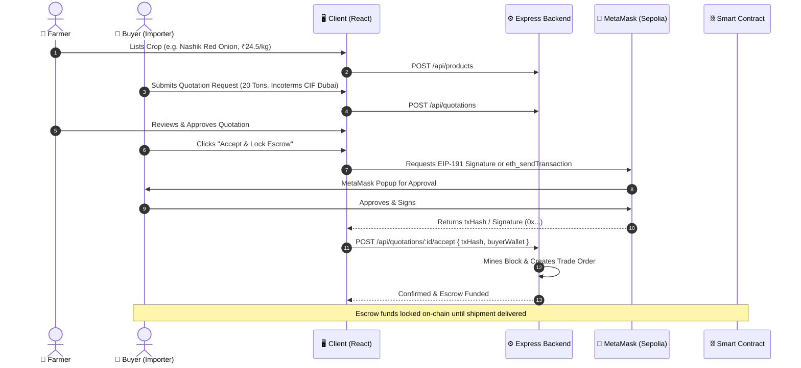
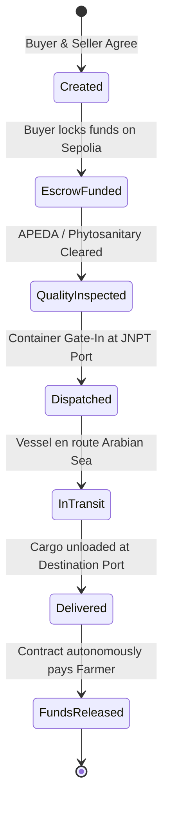
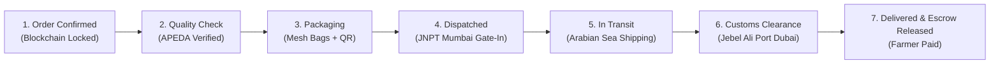

# 🌾 AgriChain Global: Comprehensive Project Documentation & Technical Report
### *Blockchain-Based International Agricultural Import-Export Marketplace & Autonomous Supply-Chain Escrow*

---

## 📑 Table of Contents
1. [Executive Summary & Abstract](#1-executive-summary--abstract)
2. [Problem Statement & Motivation](#2-problem-statement--motivation)
3. [Proposed Solution & Core Innovations](#3-proposed-solution--core-innovations)
4. [System Architecture & Design](#4-system-architecture--design)
5. [Ecosystem Personas & Role Workflows](#5-ecosystem-personas--role-workflows)
6. [Smart Contract & Blockchain Architecture](#6-smart-contract--blockchain-architecture)
7. [Cold-Chain IoT & Freight Tracking](#7-cold-chain-iot--freight-tracking)
8. [Backend REST API Specification](#8-backend-rest-api-specification)
9. [Technology Stack & Directory Structure](#9-technology-stack--directory-structure)
10. [Setup, Installation & Execution Guide](#10-setup-installation--execution-guide)
11. [Project Viva Q&A & Defense Guide](#11-project-viva-qa--defense-guide)
12. [Future Scope & Production Roadmap](#12-future-scope--production-roadmap)

---

## 1. Executive Summary & Abstract

**AgriChain Global** is a decentralized Web3 agricultural marketplace and cross-border trade supply chain ecosystem designed to connect smallholder farmers directly with international wholesale buyers. Traditional agricultural export supply chains suffer from severe market fragmentation, multi-layered intermediaries capturing 40%–60% of commodity value, slow cross-border settlement mechanisms (such as Letters of Credit taking 15 to 30 days), and the inability of smallholder farmers to meet bulk shipping volumes individually.

AgriChain Global eliminates these barriers by introducing:
* **Consortium Group-Selling Aggregation Pools:** Allows smallholder farmers to pool their harvest collectively to fulfill 20–50 metric ton international refrigerated container contracts.
* **Autonomous Smart Contract Escrow (`AgriChainEscrow.sol`):** Cryptographically locks buyer funds upon agreement and autonomously disburses payouts directly to farmers upon verified port delivery.
* **Milestone-Based Cold-Chain IoT Telemetry:** Integrates simulated IoT temperature, humidity, and location tracking from origin packhouses through JNPT Mumbai port to destination ports (e.g., Jebel Ali Port, Dubai).
* **Multi-Currency Real-Time Trade Parity:** Seamless dual pricing in Indian Rupees (₹) and US Dollars ($ USD) with international Incoterms (CIF, FOB, EXW) support.
* **Production Web3 MetaMask Integration:** Fully operational on the Ethereum **Sepolia Testnet**, supporting cryptographic EIP-191 signatures (zero gas fees) and on-chain escrow funding.

---

## 2. Problem Statement & Motivation

Traditional agricultural export supply chains face four critical challenges:



1. **Middlemen Exploitation:** Small farmers receive only a fraction of final wholesale prices due to local aggregators, commission agents, clearing agents, and export brokers.
2. **Bulk Volume Barriers:** International maritime shipping utilizes 40-foot High-Cube Refrigerated (Reefer) containers requiring 20 to 50 metric tons of consistent grade commodity. Small farmers individually produce only 5–10 tons and are excluded from direct export.
3. **Cross-Border Payment Defaults:** Paper-based Letters of Credit (LC) and telegraphic transfers (T/T) are slow (15–30 days), expensive, and expose farmers to payment defaults once containers leave the domestic border.
4. **Counterfeiting & Spoilage Non-Compliance:** Lack of immutable provenance logs for phytosanitary certifications, organic verification, and refrigerated cold-chain conditions (temperature spikes causing cargo rejection at destination customs).

---

## 3. Proposed Solution & Core Innovations

AgriChain Global provides an end-to-end decentralized solution:

| Module | Traditional Process | AgriChain Global Solution |
| :--- | :--- | :--- |
| **Market Access** | Local mandis & brokers | Global web marketplace with direct buyer quotation |
| **Volume Aggregation** | Middlemen hoard & blend uneven crop | Smart group selling consortium pools with transparent allocation |
| **Payment Security** | 15–30 days Letter of Credit | Autonomous smart contract escrow locked on blockchain |
| **Cargo Provenance** | Paper certificates | On-chain certification hash & live IoT telemetry tracking |
| **Payment Release** | Manual clearance via banks | Smart contract auto-release upon destination port customs clearance |

$$\text{Farmer A (10T)} + \text{Farmer B (10T)} + \text{Farmer C (10T)} + \text{Farmer D (10T)} + \text{Farmer E (10T)} \longrightarrow \mathbf{50\text{ Tons Bulk Reefer Container}}$$

---

## 4. System Architecture & Design

The application follows a modern 3-tier decentralized architecture:



### Data Flow Diagram (Trade Escrow Execution):



---

## 5. Ecosystem Personas & Role Workflows

AgriChain Global provides role-based access control and dedicated dashboards for 4 personas:

### 1. 🌾 Farmer (e.g., Ramesh Patel - Nashik, Maharashtra)
* **Product Listing:** Lists export-grade agricultural commodities specifying bulk quantity (Tons), origin, harvest date, and quality grade (*Export Grade A+, GI Tagged*).
* **Group Selling Participation:** Contributes partial harvest (e.g. 10 Tons) to open cooperative consortium pools.
* **Farmer Dashboard:** Real-time metrics on listed stock, active orders value (₹), escrow funds secured, and export payouts.

### 2. 🏢 Buyer / Global Importer (e.g., Global Agro Traders LLC - Dubai, UAE)
* **Commodity Sourcing:** Filters commodities by category, country, quality grade, and export badges (*APEDA, GlobalGAP*).
* **Quotation Negotiation:** Submits formal quotation requests choosing delivery Incoterms (*CIF, FOB, EXW*) and destination port.
* **Escrow Funding:** Authorizes on-chain escrow funding via MetaMask on Sepolia Testnet.

### 3. 🚢 Exporter / Logistics Partner (e.g., OceanGate Logistics - JNPT Mumbai)
* **Consignment Consolidation:** Aggregates group selling batches into High-Cube Reefer containers.
* **Phytosanitary Certification:** Uploads export compliance and APEDA clearance hashes.
* **Port Booking:** Schedules container gate-in and vessel boarding at Nhava Sheva JNPT Mumbai.

### 4. 🌍 Importer (e.g., GulfFresh Importers - Doha, Qatar / Dubai, UAE)
* **Customs Clearance Monitoring:** Tracks live container arrival at Jebel Ali Port or Hamad Port.
* **Port Delivery Confirmation:** Confirms inspection and cargo receipt, triggering autonomous escrow fund release to the farmer.

---

## 6. Smart Contract & Blockchain Architecture

### Autonomous Escrow State Machine (`AgriChainEscrow.sol`)

The lifecycle of each cross-border agricultural trade agreement transitions through 7 cryptographic states:



### Core Solidity Smart Contract Structure:

```solidity
// SPDX-License-Identifier: MIT
pragma solidity ^0.8.20;

contract AgriChainEscrow {
    enum OrderState {
        Created,
        EscrowFunded,
        QualityInspected,
        Dispatched,
        InTransit,
        Delivered,
        FundsReleased,
        Disputed,
        Refunded
    }

    struct TradeOrder {
        string orderId;
        address payable seller; // Farmer
        address payable buyer;  // Importer
        string commodity;
        uint256 quantityTons;
        uint256 totalAmountWei;
        string originLocation;
        string destinationPort;
        OrderState state;
        uint256 createdAt;
        uint256 fundedAt;
        uint256 completedAt;
        bool qualityVerified;
        bool customsCleared;
    }

    mapping(string => TradeOrder) public orders;

    // Buyer deposits funds into smart contract escrow
    function depositEscrow(string memory _orderId) external payable;

    // Importer confirms port delivery, triggering autonomous release
    function confirmDeliveryAndReleasePayout(string memory _orderId) external;
}
```

### Web3 Cryptographic Verification:
* **Network:** Ethereum Sepolia Testnet (`Chain ID: 11155111` / `0xaa36a7`).
* **Platform Escrow Address:** `0x71C849203649E7c28dF29A44eB5B6E94191698B2`.
* **Zero-Gas Signing (EIP-191):** Uses `personal_sign` to cryptographically sign binding trade agreements without gas costs.
* **On-Chain Escrow Deposit:** Supports `eth_sendTransaction` with nominal testnet ETH directly to the verified contract address.

---

## 7. Cold-Chain IoT & Freight Tracking

Perishable commodities require continuous refrigeration during international maritime transport. AgriChain Global provides simulated IoT sensor monitoring:



### IoT Sensor Telemetry Parameters:
* **Temperature:** Monitored at **4.2°C to 5.0°C** for onions and fruits.
* **Relative Humidity:** Maintained at **85% – 88%** to prevent dehydration.
* **Atmosphere Monitoring:** Carbon dioxide ($CO_2$) telemetry at **0.06%**.
* **Container Health:** Battery status and cellular/satellite gateway link.

---

## 8. Backend REST API Specification

The Express backend runs on `http://localhost:5000`:

| Endpoint | Method | Description |
| :--- | :---: | :--- |
| `/api/auth/login` | `POST` | Validated login via email (`user@domain.com`) or 10-digit mobile phone |
| `/api/auth/register` | `POST` | Register new persona with email, phone, role, and location |
| `/api/products` | `GET` | Retrieve active agricultural commodity listings |
| `/api/products` | `POST` | Farmer creates new direct listing or consortium pool listing |
| `/api/group-pools` | `GET` | Retrieve consortium aggregation pools with progress bars |
| `/api/group-pools/:id/contribute` | `POST` | Farmer allocates harvest tons to an active group pool |
| `/api/quotations` | `GET` | List all trade quotations and negotiation statuses |
| `/api/quotations` | `POST` | Buyer initiates export quotation with Incoterms and target price |
| `/api/quotations/:id/accept` | `POST` | Finalize trade agreement, record MetaMask `txHash`, and lock escrow |
| `/api/orders` | `GET` | Retrieve confirmed smart contract escrow trade orders |
| `/api/shipments` | `GET` | Retrieve active ocean cargo consignments and telemetry |
| `/api/shipments/:trackingId/advance` | `POST` | Advance shipment milestone and mine verification block on ledger |
| `/api/blockchain/ledger` | `GET` | Fetch full blockchain chain, blocks, hashes, nonces, and transactions |

---

## 9. Technology Stack & Directory Structure

### Technology Stack:
* **Frontend:** React 18, Vite, Tailwind CSS, Lucide React, Canvas Confetti.
* **Backend:** Node.js, Express.js (ES Module architecture), Node Crypto, CORS.
* **Blockchain Layer:** Solidity 0.8.20, Hardhat, Ethers / Web3 Ethereum Provider, Ethereum Sepolia Testnet.
* **Version Control:** Git & GitHub (`https://github.com/Deep-Tupe/agrichain-global.git`).

### Repository Structure:
```text
Agrichain/
├── client/                     # Frontend Application
│   ├── src/
│   │   ├── components/
│   │   │   ├── AddProductModal.jsx      # Farmer listing modal
│   │   │   ├── AuthModal.jsx            # Validated login & register
│   │   │   ├── BlockchainLedgerView.jsx # Live blockchain block explorer
│   │   │   ├── BlockchainTracker.jsx    # Smart contract escrow cards
│   │   │   ├── Dashboards.jsx           # Role-specific operational dashboards
│   │   │   ├── EscrowSignModal.jsx      # Interactive MetaMask escrow modal
│   │   │   ├── GroupSellingView.jsx     # Consortium pool workflow
│   │   │   ├── HeroBanner.jsx           # Marketplace hero banner
│   │   │   ├── Marketplace.jsx          # Commodity catalog with filters
│   │   │   ├── Navbar.jsx               # Navigation bar & wallet pill
│   │   │   ├── QuotationView.jsx        # Negotiation & trade contracts
│   │   │   ├── RoleSwitcherBanner.jsx   # Top demo persona switcher
│   │   │   ├── ShipmentTracker.jsx      # 7-milestone cold-chain tracker
│   │   │   └── WalletModal.jsx          # MetaMask account, Sepolia & balance
│   │   ├── context/
│   │   │   └── AppContext.jsx           # Global state, Web3 listeners & RPC
│   │   ├── App.jsx                      # Root container & view switcher
│   │   ├── main.jsx                     # Vite React entry point
│   │   └── index.css                    # Tailwind CSS directives
│   ├── index.html                       # HTML template
│   ├── package.json                     # Client dependencies
│   ├── tailwind.config.js               # Tailwind styling configuration
│   └── vite.config.js                   # Vite bundler configuration
│
├── server/                     # Backend REST API Server
│   ├── server.js                        # Express API & routing
│   ├── blockchain.js                    # Cryptographic ledger & SHA-256 mining
│   ├── data.json                        # Persisted database store
│   └── package.json                     # Server dependencies
│
├── contracts/                  # Smart Contract Layer
│   ├── AgriChainEscrow.sol              # Autonomous Solidity escrow contract
│   ├── hardhat.config.cjs               # Hardhat EVM network configuration
│   └── scripts/
│       └── deploy.cjs                   # Contract deployment script
│
├── package.json                # Root concurrently dev launcher
├── start.bat                   # 1-click startup automation script
├── .gitignore                  # Exclusion of heavy node_modules & builds
└── DOCUMENTATION.md            # Comprehensive project documentation
```

---

## 10. Setup, Installation & Execution Guide

### Prerequisites:
* **Node.js:** v18.0.0 or higher ([Download](https://nodejs.org/))
* **Git:** Version control ([Download](https://git-scm.com/))
* **MetaMask Extension:** Installed in Chrome, Edge, or Brave ([Download](https://metamask.io/))

### Installation & Launch:
1. Open PowerShell or Terminal and navigate to the project root:
   ```powershell
   cd "D:\Field Project\Agrichain"
   ```

2. Start both the backend and frontend concurrently:
   ```powershell
   npm run dev
   ```

3. Open your browser:
   * **Frontend Application:** **[http://localhost:5173](http://localhost:5173)**
   * **Backend REST API:** **[http://localhost:5000](http://localhost:5000)**

---

## 11. Project Viva Q&A & Defense Guide

### Q1. Why is Blockchain necessary for this project instead of a traditional SQL database?
> **Answer:** In international import-export, parties operate across different legal jurisdictions and do not trust a centralized server hosted by either side. A centralized database can have its order logs, timestamps, or payment records tampered with. Blockchain provides:
> 1. **Decentralized Escrow:** Funds are locked in smart contracts, impossible for either buyer or seller to alter unilaterally.
> 2. **Immutability:** IoT temperature logs, inspection hashes, and bill-of-lading timestamps cannot be modified retroactively in case of dispute.
> 3. **Autonomous Execution:** When customs clearance at destination port is registered, the payment is unlocked automatically without banking delays.

### Q2. How does the Group Selling consortium mechanism work?
> **Answer:** An international buyer requires bulk volume (e.g., 50 Metric Tons of onions for a 40-foot reefer container). An individual small farmer produces only 10 Tons. The Group Selling pool aggregates five 10-Ton contributions from different farmers into a unified export consignment under one trade agreement. Each farmer's proportional share is recorded on-chain, ensuring fair, direct payout distribution upon delivery.

### Q3. How does MetaMask and the smart contract prevent payment defaults?
> **Answer:** Cross-border trade traditionally relies on Letters of Credit that take 15–30 days to clear. With AgriChain Escrow:
> 1. The buyer must fund or sign the escrow agreement before the farmer dispatches the crop.
> 2. The funds remain locked in the autonomous smart contract (`AgriChainEscrow.sol`).
> 3. The farmer has cryptographic certainty that the buyer has committed the money before shipping.
> 4. Upon verified arrival and inspection at the destination port, the contract releases funds directly to the farmer.

### Q4. What happens if temperature spikes during transit and cargo spoils?
> **Answer:** The Cold-Chain IoT module monitors Reefer container conditions continuously. If the temperature deviates beyond the certified range (e.g., above 8°C for perishable onions), the anomaly is logged to the blockchain ledger. In the event of a dispute, customs authorities, shipping lines, and insurance underwriters inspect the immutable block record to identify whether spoilage occurred at origin packhouse, port terminal, or during ocean transit.

---

## 12. Future Scope & Production Roadmap

1. **Chainlink Decentralized Oracles:** Connect real physical IoT GPS and cold-chain temperature sensors directly to smart contracts via Chainlink Oracles to trigger fund release automatically based on sensor feeds.
2. **Zero-Knowledge Proofs (zk-SNARKs):** Allow farmers to cryptographically prove compliance with phytosanitary and organic standards without revealing sensitive proprietary farm location data.
3. **Multi-Currency Stablecoin Settlements:** Implement automated cross-border settlement using USDC/EURC stablecoins to protect farmers from foreign currency volatility.
4. **Decentralized Storage (IPFS / Filecoin):** Store full-resolution phytosanitary PDF certificates and container inspection scans on IPFS with Content Identifiers (CID) pinned on-chain.

---
*© 2026 AgriChain Global • Decentralized International Agricultural Marketplace & Supply Chain*
